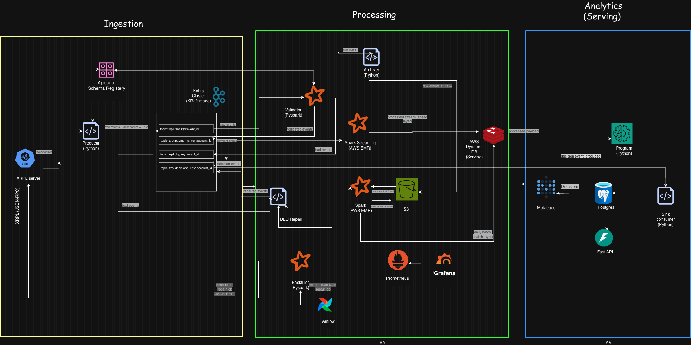

# XRPL Real-Time Risk Engine

Real-time risk decisioning on live XRP Ledger payments. Every payment is validated, enriched with rolling per-account behaviour features, and given an explainable decision (allow / review / block) within seconds.

## Architecture

1. **Ingest:** producer subscribes to XRPL over WebSocket → `xrpl.raw`
2. **Validate:** PySpark validator dedups and checks events → `xrpl.payments` (invalid → `xrpl.dlq`)
3. **Archive:** raw events → S3 `/raw/` for replay and batch
4. **Real-time features:** Spark Structured Streaming → Redis `rt:{account}`
5. **Batch features:** daily Spark job (Airflow) → Redis `batch:{account}`
6. **Decide:** decision service applies versioned rules → `decisions`
7. **Serve:** PostgreSQL → Metabase dashboards and FastAPI
8. **Observe:** Prometheus + Grafana

## Tech stack

Python · Kafka · Schema Registry · PySpark Structured Streaming · Redis · PostgreSQL · Airflow · S3 / MinIO · FastAPI · Prometheus · Grafana · Docker

## Repository structure

| Folder | Purpose |
|---|---|
| `docs/` | Requirements, architecture, operations docs and ADRs (`docs/decisions/`) |
| `schemas/` | Event schemas registered in Schema Registry |
| `producers/` | XRPL WebSocket producer → `xrpl.raw` |
| `streaming/` | PySpark validator and Structured Streaming feature jobs |
| `risk_engine/` | Decision service and versioned rules |
| `api/` | FastAPI service |
| `storage/` | PostgreSQL, Redis and S3 / MinIO setup |
| `tests/` | Unit and integration tests |
| `monitoring/` | Prometheus and Grafana config |
| `docker/` | Dockerfiles and compose files |
| `scripts/` | Helper scripts |
| `.github/workflows/` | CI/CD pipelines |
