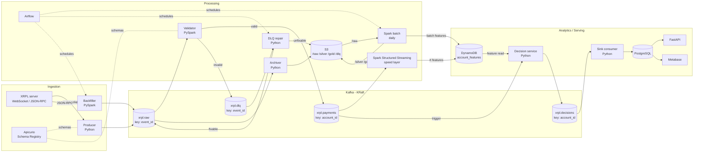

# Architecture: Real-Time Risk & Decisioning Platform

> Status: draft (design v5). For what the system must do and the P0/P1/P2 priorities, see [REQUIREMENTS.md](REQUIREMENTS.md).

## 1. Overview

A streaming platform that scores **live payments** in near real time and returns **explainable risk decisions** from rolling per-account behaviour.

- **Data source:** [XRP Ledger (XRPL)](https://xrpl.org/docs/references/http-websocket-apis/public-api-methods), a public payments network. Free, no API key, live WebSocket push; JSON-RPC for historical and gap fetches.
- **Entity:** XRPL account (`account_id`). All behavioural features are computed per account.
- **Output:** one decision per payment (`allow` / `review` / `block`) with a score, reasons, and the rule version that produced it.

## 2. High-Level Design

The system is split into three zones.

| Zone | Responsibility |
|---|---|
| **Ingestion** | Receive XRPL events, wrap them in an envelope, enforce contracts, publish to Kafka |
| **Processing** | Validate, deduplicate, archive, compute real-time and batch features, handle problem events |
| **Analytics (Serving)** | Serve features, make decisions, store and expose decisions |

Prometheus and Grafana scrape every service and are left out of the diagram for readability.

### End-to-end flow

1. XRPL (WebSocket) → Producer → `xrpl.raw`
2. Backfiller (JSON-RPC, Airflow) → `xrpl.raw`
3. `xrpl.raw` → Validator → `xrpl.payments`; invalid → `xrpl.dlq`
4. `xrpl.raw` → Archiver → S3 `/raw/`
5. `xrpl.payments` → Spark Streaming → DynamoDB (real-time features)
6. S3 `/raw/` → Spark batch (daily, Airflow) → DynamoDB + S3 `/silver/` `/gold/`
7. `xrpl.dlq` → DLQ repair (Airflow) → `xrpl.raw`
8. `xrpl.payments` → Decision service (reads DynamoDB) → `xrpl.decisions`
9. `xrpl.decisions` → Sink consumer → PostgreSQL → Metabase / FastAPI

## 3. Key Technology Decisions

| Area | Decision | Why |
|---|---|---|
| Event bus | Kafka, single cluster in **KRaft mode** | Buffers bursts, supports replay; KRaft removes ZooKeeper |
| Schema registry | **Apicurio** (self-hosted) | Open-source data contracts on every topic write |
| Stream and batch processing | **PySpark** (Structured Streaming + batch) | One stack for both layers; built-in watermarking and dedup |
| Serving store | **AWS DynamoDB** (DynamoDB Local in development) | Key-value lookups per account, native TTL |
| Custom services | Python | Producer, archiver, DLQ repair, decision service, sink consumer |
| Decision storage and access | PostgreSQL + FastAPI + Metabase | Queryable history, read-only API, BI dashboards |
| Orchestration | Airflow | Batch, DLQ repair, replay and backfill scheduling |
| Monitoring | Prometheus + Grafana | Metrics, SLO panels, alerts |
| Deployment | Local Docker now; AWS (EMR, DynamoDB, S3) for the cloud phase | Keeps cost near zero while building |

## 4. Components

| Component | Role | Zone | Type |
|---|---|---|---|
| Producer (Python) | WebSocket → envelope → `xrpl.raw` | Ingestion | Core |
| Kafka (KRaft) | Event bus and buffer | Ingestion | Core |
| Apicurio Schema Registry | Data contracts on every topic write | Ingestion | Core |
| Backfiller (PySpark) | Gap and historical fetch via JSON-RPC | Ingestion | Supporting |
| Validator (PySpark) | Validity, normalisation, dedup, DLQ routing | Processing | Core |
| Archiver (Python) | `xrpl.raw` → S3 `/raw/` | Processing | Core |
| Spark Structured Streaming | Event time, windows, real-time features | Processing | Core |
| Spark batch | Daily long-window features | Processing | Supporting |
| S3 | Raw archive, silver/gold, DLQ archive | Processing | Core |
| DLQ repair (Python) | Fix and resubmit DLQ events | Processing | Supporting |
| Airflow | Batch, DLQ repair, replay, backfill scheduling | Processing | Supporting |
| Prometheus + Grafana | Metrics, dashboards, alerts | Processing | Supporting |
| AWS DynamoDB | Serving store for online features (rt, batch) | Serving | Core |
| Decision service (Python) | Rules + reasons (model later) | Serving | Core |
| Sink consumer (Python) | `xrpl.decisions` → PostgreSQL | Serving | Core |
| PostgreSQL | Decision store | Serving | Core |
| FastAPI | Read-only decision API | Serving | Core |
| Metabase | BI dashboards | Serving | Supporting |
| Replayer / chaos tool | Replay and load/failure tests | Processing | Supporting |

## 5. Design Details

### 5.1 Why a separate validator

The validator owns data quality; Spark Streaming owns event-time logic and features. `xrpl.payments` becomes a trusted topic any consumer can use. The cost is one more service and one extra Kafka hop (about 1–2 s of micro-batch latency, within the 5 s SLO). PySpark keeps one stack and gives native dedup.

### 5.2 Lambda design: speed and batch layers

- **Speed layer** (Spark Structured Streaming on `xrpl.payments`): event time = `close_time_iso`, 2 min watermark, sliding windows (10 min velocity, 1 h fan-out and failures). Writes `rt` features with a 2 h TTL.
- **Batch layer** (daily Spark on S3 `/raw/`): long-window features (30-day averages, usual counterparties and hours, account age) and late events the speed layer skipped. Writes `batch` features with a 48 h TTL, so one failed run does not empty the store.
- **Merge at read time:** the decision service reads both items for an account in one query; batch features enrich real-time ones.

### 5.3 Serving data model

Single DynamoDB table `account_features`:

- Partition key `account_id`, sort key `feature_set` (`rt` | `batch`), so the two layers never overwrite each other.
- TTL attribute `expires_at`. DynamoDB deletes expired items with a delay, so readers ignore items past `expires_at`.

### 5.4 Kafka topics and partitioning

| Topic | Key | Written by | Read by | Retention |
|---|---|---|---|---|
| `xrpl.raw` | `event_id` | Producer, backfiller, DLQ repair, replayer | Validator, archiver | 7 days |
| `xrpl.payments` | `account_id` | Validator | Spark Streaming, decision service | 3 days |
| `xrpl.dlq` | `event_id` | Validator | DLQ repair, Grafana | 14 days |
| `xrpl.decisions` | `account_id` | Decision service | Sink consumer | 7 days |

**Key rule:** key by `event_id` where data is raw or broken (no trusted account yet, even spread, duplicates land together); key by `account_id` where data is clean and per-account order matters. Categories such as `reason_code` or `event_type` go in fields and headers, not keys.

**Hot partitions:** heavy accounts are salted (`account_id#0..n`) on account-keyed topics and merged downstream.

### 5.5 Storage

| Store | Key | Written by | Read by | Retention / TTL |
|---|---|---|---|---|
| DynamoDB `account_features` (rt) | `account_id` + `rt` | Spark Streaming | Decision service | TTL 2 h |
| DynamoDB `account_features` (batch) | `account_id` + `batch` | Spark batch | Decision service | TTL 48 h |
| S3 `/raw/` | date partitions | Archiver | Spark batch, replayer | 90 days |
| S3 `/silver/` `/gold/` | date partitions | Spark batch | Analytics, history | TBD |
| S3 `/dlq/` | date partitions | DLQ repair | Manual review | TBD |
| PostgreSQL `decisions` | `event_id` | Sink consumer | Metabase, FastAPI | 30 days (partitioned by day) |

S3 `/raw/` keeps every event as received, including invalid and late ones, and is the source of truth for replay and batch.

### 5.6 Problem events

| Problem event | Goes to | Put there by | Handled by | When |
|---|---|---|---|---|
| Invalid (missing field, failed tx, unknown amount format) | `xrpl.dlq` + `reason_code` | Validator | DLQ repair (Airflow) | Hourly |
| Fixed (repaired DLQ event) | Back to `xrpl.raw` | DLQ repair | Validator (re-checked) | After repair |
| Unfixable | S3 `/dlq/` | DLQ repair | Manual review | — |
| Late (> 2 min for real time) | Already in S3 `/raw/` | Archiver | Spark batch | Daily |
| Duplicate | Dropped | Validator (dedup) | — | Real time |

### 5.7 Replay and backfill

- **Replay:** re-read a chosen S3 `/raw/` range into `xrpl.raw` after a rule change or re-validation.
- **Backfiller:** fetches gaps and historical ranges from XRPL via JSON-RPC (`ledger_index` + `ledger`) into `xrpl.raw`, throttling itself on `"warning": "load"`.
- **Replayer / chaos tool:** replays recorded data at 10–100x with injected duplicates, delays, reordering, hot keys, malformed events and bursts, for load and failure testing.

## 6. Observability

- Every service exposes Prometheus metrics: events in vs decisions out per second, consumer lag per partition, DLQ count by reason, late events, retries, WebSocket reconnects.
- Grafana dashboards query Prometheus; the latency SLI (`decided_at − received_at`) has an SLO panel and alerts (Slack/email).

## 7. Deployment

- **Now:** everything runs in Docker Compose locally (Kafka, Apicurio, Spark, DynamoDB Local, PostgreSQL, Airflow, Prometheus, Grafana, Metabase).
- **Cloud phase:** Spark on AWS EMR; DynamoDB and S3 on AWS; other services on EC2. AWS runs only for demo and load-test sessions and is shut down afterwards.
- **Availability trade-off:** single region, no multi-region; single points of failure are documented as accepted risks.
